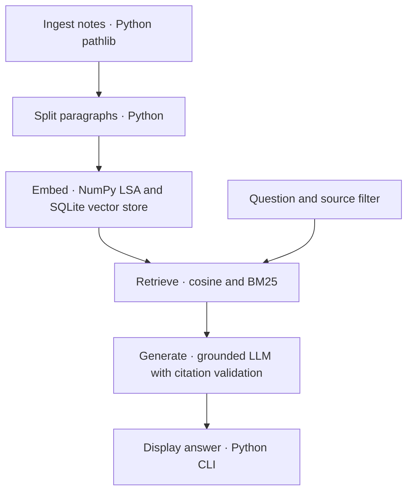

# Planning · The Unofficial Howard Guide

## Domain

Students planning the time between classes need to know which rooms work for a group, where to buy a few groceries, and what an event actually feels like. Howard’s student newspaper reports details such as room numbers, booking practices and individual experiences across several years. The guide will answer questions about this reporting and date its citations so readers can tell when an observation was made.

## Documents

The inputs are ten locally stored sets of paraphrased reporting notes. Each blank-line-separated passage covers one detail from the linked article. The notes preserve dates and distinguish individual experiences from general claims.

| Local source | Original student newspaper article |
|---|---|
| `documents/study.txt` | [Best Places to Study on Campus](https://thehilltoponline.com/2023/08/21/best-places-to-study-on-campus/) |
| `documents/founders.txt` | [Founders Library Reveals New Study Space](https://thehilltoponline.com/2026/02/16/founders-library-reveals-new-study-space/) |
| `documents/pantry.txt` | [New Food Pantry Aims to Tackle Food Insecurity at Howard](https://staging.thehilltoponline.com/2023/11/06/new-food-pantry-aims-to-tackle-food-insecurity-at-howard/) |
| `documents/groceries.txt` | [Where to Shop Without Mom and Pop](https://thehilltoponline.com/2022/08/15/where-to-shop-without-mom-and-pop/) |
| `documents/closures.txt` | [Georgia Ave Restaurant Closures Leave Students Asking: What is Left to Eat?](https://thehilltoponline.com/2025/09/08/georgia-ave-restaurant-closures-leave-students-asking-what-is-left-to-eat/) |
| `documents/artivism.txt` | [Sankofa Hosts Weekly “Artivism” Jam Sessions](https://thehilltoponline.com/2025/10/06/sankofa-hosts-weekly-artivism-jam-sessions/) |
| `documents/guide.txt` | [A Beginner’s Guide to Washington, D.C., According to Bison](https://thehilltoponline.com/2025/08/18/a-beginners-guide-to-washington-d-c-according-to-bison/) |
| `documents/georgia.txt` | [Ethiopian Businesses Build Community Along Georgia Avenue](https://thehilltoponline.com/2026/08/31/ethiopian-businesses-build-community-along-georgia-avenue/) |
| `documents/plans.txt` | [Howard Introduces New Meal Plans for 2026-27 School Year](https://thehilltoponline.com/2026/08/17/howard-introduces-new-meal-plans-for-2026-27-school-year/) |
| `documents/aramark.txt` | [New Dining Experience: Aramark Collegiate Hospitality](https://thehilltoponline.com/2025/09/02/new-dining-experience-aramark-collegiate-hospitality/) |

## Chunking Strategy

Keep one paragraph per chunk, with a ceiling of 75 whitespace tokens and zero overlap between distinct paragraphs. A paragraph often pairs a location with its access rule. Keeping that pair together allows one citation to support both facts. For an unusually long paragraph, use windows of 75 tokens with 12 tokens of overlap to preserve terms near the boundary. Compare this strategy with 12-token, zero-overlap windows across each file.

## Retrieval Approach

Fit a 16-dimensional latent semantic analysis (LSA) embedding using TF–IDF and truncated singular value decomposition on the source paragraphs. Save the vectors and term projection to SQLite. Rank by cosine similarity and return four passages. Local training keeps the collection reproducible, and four passages leave room for an alternative account while keeping the evidence short. For production, benchmark a pretrained sentence encoder on paraphrases, campus abbreviations and multilingual questions. Measure latency on student hardware, memory use and evidence recall before paying for a hosted model.

## Evaluation Plan

| Question | Ground truth |
|---|---|
| Which room did the 2023 study guide identify as the largest study room in Towers West? | P-42 in Howard Plaza Towers West. |
| In the 2023 report, where was The Store @ HU and how did students visit? | The first floor of Blackburn University Center, by appointment. |
| Which night was the Sankofa Artivism jam, and who hosted it in October 2025? | Tuesday nights, hosted by Joshua Hughes and Isaac Alicea. |
| Which two dining halls accepted meal swipes in the 2026–27 report? | Blackburn Café and Bethune Annex Café. |
| What was the street number of the supermarket with a dispensary in the 2022 shopping guide? | 1345, the Giant Food address on Park Road NW. The article uses the word pharmacy. |

## Anticipated Challenges

- A source might refer to a pharmacy while a visitor asks about a dispensary. A small corpus gives a learned model few chances to connect those terms.
- Multiple articles describe Sankofa, and a story about studying there could outrank a report naming the jam hosts. Inspect rankings against passages that contain the answer.
- Dining policies change. Preserve article dates at display time and describe historical claims as reported.

## Architecture

## AI Tool Plan

Use ChatGPT to implement the tokenizer and chunker from the size and overlap rules above. Check a long paragraph and inspect five stored passages. Use the retrieval specification to build cosine ranking and trace a returned ID back to its article. For generation, provide the ranked chunks and require evidence IDs that can be resolved to the original URLs. Test a question about an unrelated subject.

## Stretch work

Before implementing the extensions, compare semantic-only, BM25 and hybrid retrieval on the same questions. Compare both chunkers against the same evidence requirements. Expose a source filter, and use the most recent cited source for explicit follow-ups. Run a fresh-session control for memory.
